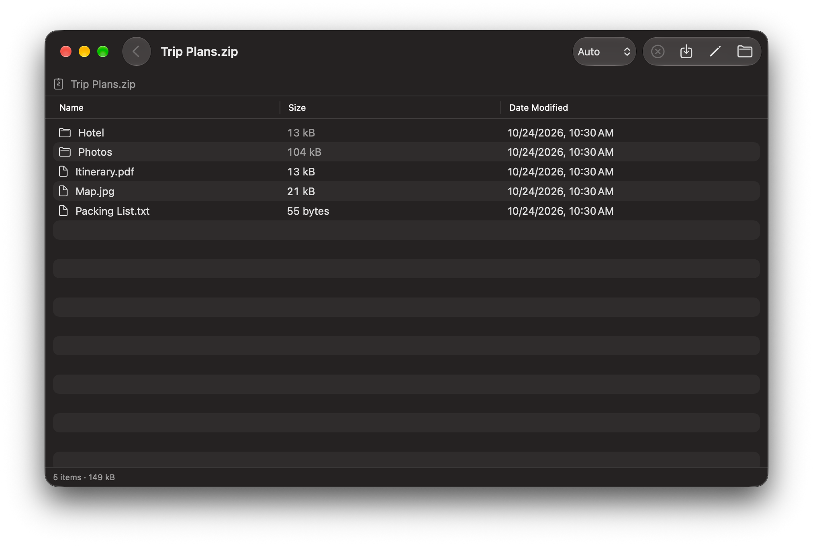

# Nakami

**Look inside an archive before you extract it.**

[日本語](README.ja.md)

Nakami is a free archive manager for the Mac, in the spirit of the 7-Zip File Manager on Windows.
When you double-click a zip file on a Mac, Archive Utility extracts everything right away.
Nakami opens it as a list instead, so you can browse the folders, preview files, and take out only what you need.

<p align="center"></p>

*Nakami* (中身) is Japanese for "contents".

## Features

- **Browse archives like folders** — names, sizes, and dates; open folders inside the archive and go back up
- **Extract only what you need** — select files and press ⌘E, or drag them to the Finder
- **Open and preview** — double-click a file to open it, or press Space to see it with Quick Look
- **Quick Look in the Finder** — select an archive in the Finder and press Space to see the list of files inside
- **No garbled file names** — zip files made on Japanese Windows (Shift_JIS) are detected automatically, and you can switch the encoding by hand
- **Password-protected zip files** — both ZipCrypto and AES
- **Create archives** (⌘N) — drop files and folders, arrange them, and save as zip, 7z, tar.gz, or tar.xz.
  Mac-only junk files (`.DS_Store`, `__MACOSX`, `._*`) are never included.
  For zip, you can choose UTF-8 or Shift_JIS file names and add a password
- **Edit existing archives** — add, remove, and rename files in zip, 7z, tar.gz, and tar.xz archives.
  When you save, the original archive is moved to the Trash, so you can get it back
- **Compress from the Finder** — right-click files and choose **Services → Compress with Nakami**
- **English and Japanese**
- **Works offline** — Nakami does not connect to the internet and does not collect any data

### Supported formats

| | Formats |
| --- | --- |
| Open and extract | zip, 7z, rar, tar, tar.gz (tgz), tar.bz2, tar.xz, gz, bz2, xz, lzh (lha), cab, cpio, xar, Z |
| Create and edit | zip, 7z, tar.gz, tar.xz |
| Passwords | zip only (7z and rar archives with passwords can be listed but not extracted) |

## Requirements

- A Mac with Apple silicon (M1 or later, etc. — not Intel Macs)
- macOS 27.2 or later

You can check both in Apple menu → **About This Mac**. If it shows **Chip** with an Apple chip, your Mac has Apple silicon. If it shows **Processor** with Intel, it is an Intel Mac.

## Install

1. Download `Nakami-x.y.zip` from the [latest release](https://github.com/synchrium/Nakami/releases/latest).
2. Double-click the zip file to extract `Nakami.app`.
3. **Drag `Nakami.app` to the Applications folder in the Finder.**
   (Please move it with the Finder. If you open it without moving it, macOS runs it from a temporary location.)

### Opening Nakami for the first time

Nakami is free and is not notarized by Apple (that requires a paid Apple Developer membership),
so macOS asks you to confirm before opening it the first time.

1. Double-click Nakami in the Applications folder. You will see **"Nakami" Not Opened**. Click **Done**.
   (Do not click "Move to Trash".)
2. Open **System Settings → Privacy & Security** and scroll down to the **Security** section.
3. Next to **"Nakami" was blocked to protect your Mac**, click **Open Anyway**.
4. Click **Open Anyway** again, and enter your password (or use Touch ID).

After this, Nakami opens normally.

<details>
<summary>Using Terminal instead</summary>

If you are comfortable with Terminal, this command does the same thing as the steps above:

```sh
xattr -dr com.apple.quarantine /Applications/Nakami.app
```

</details>

### Updating to a new version

Replace `Nakami.app` in the Applications folder with the new one.
**macOS treats each new version as a new app, so you need to do the steps in
[Opening Nakami for the first time](#opening-nakami-for-the-first-time) again.**
macOS may also ask whether the new version can use the data of the previous version (your settings). Click **Open Anyway**.
The first time you press Space in the Finder after updating, macOS may ask the same about Nakami's Quick Look extension.

## Make Nakami open archives when you double-click them

Open **Nakami → Settings… (⌘,) → Default App** and turn on the types you want, or click **Turn All On**.
macOS asks you to confirm for each type. This is how macOS protects your choice of apps, and it cannot be done all at once.

You can also do this in the Finder: select an archive, choose **File → Get Info (⌘I)**,
pick Nakami under **Open with**, and click **Change All…**.

## Keyboard shortcuts

| Keys | Action |
| --- | --- |
| ⌘O | Open an archive |
| ⌘N | Create a new archive |
| ⌘E | Extract (everything if nothing is selected) |
| Return / double-click | Open a folder or a file |
| ⌘↑ or ⌫ | Go up one folder |
| Space | Quick Look |
| ⌥⌘A | Deselect all |
| ⌘? | Show all keyboard shortcuts (with the Windows equivalents) |

In the new archive window: ⇧⌘N new folder, ⌘⌫ remove from the archive (your files are not deleted), ⌘S save.

## Build from source

You need Xcode 27 or later.

1. Clone this repository and open `Nakami.xcodeproj`.
2. In **Signing & Capabilities**, choose your own team for the Nakami and NakamiQuickLook targets.
3. Press ⌘R.

To make the same build as the releases (ad-hoc signed, with no personal information in the app), run:

```sh
Scripts/build-dist.sh
```

Nakami uses [libarchive](https://www.libarchive.org/) that comes with macOS.
The repository only contains two of its header files, in `CArchive/`.

## License

[MIT License](LICENSE). Nakami uses libarchive, which is under the BSD 2-Clause License.
See [THIRD_PARTY_NOTICES.md](THIRD_PARTY_NOTICES.md).

Nakami is provided as is, without warranty of any kind. The author is not liable for any damages arising from its use.
Please keep backups of important files. See [LICENSE](LICENSE) for details.
